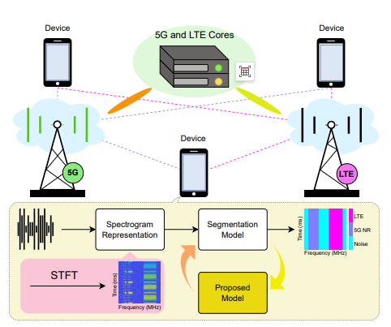
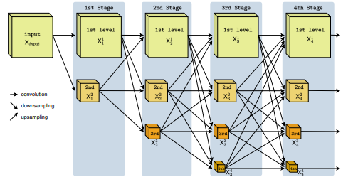
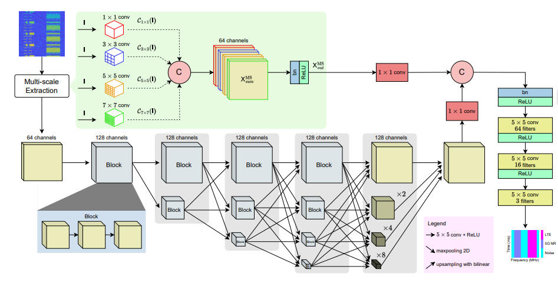
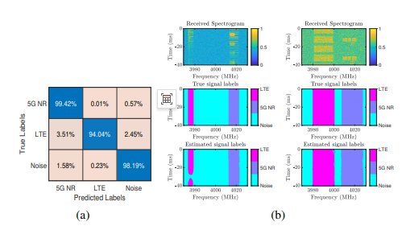

# Spectrum Sensing: A Multi-Scale Network for Semantic Segmentation of 5G-LTE Signals Based on Spectral Diagrams in Spectrum Sensing

Resolution-Preserving Multiscale Network for Semantic Segmentation in Spectral Sensing Based on Spectral Images of 5G-LTE Signals
Abstract: In this paper, we propose a novel semantic segmentation model aimed at enhancing the accuracy of 5G New Radio (NR) and Long-Term Evolution (LTE) signal segmentation within spectral images in intelligent spectrum sensing. To address the challenge of retaining key signal information in spectral feature learning, we have developed a resolution-preserving multiscale network (RPMSN), an efficient deep network architecture for semantic segmentation. This model utilizes two components - the resolution-preserving architecture and multiscale blocks - to not only maintain input resolution but also extract multiscale features, making it particularly suitable for segmenting broadband spectral images. Compared with various state-of-the-art architectures such as UNet, U-Net++, DeepLabV3, DeepLabV3+, FPN, and PSPNet, RPMSN not only achieves significantly better performance but also performs exceptionally well even in scenarios with different channel impairments: an average accuracy of 97.22%, an average mIoU of 95.42%, and an average F1 score of 97.64%. Simultaneously, the model parameters are kept within a manageable scale of 14.5 million, demonstrating high efficiency.
Keywords: 5G New Radio (5G NR), Computer Vision, Deep Learning, Resolution-Preserving Architecture, Signal Recognition, Spectral Sensing
1. Introduction With the rapid growth in the number of connected devices and their application diversity, there is an urgent need for efficient spectrum management technologies to ensure device coexistence, reduce interference, and optimize bandwidth utilization. Spectrum perception, as a core component of cognitive radio networks [1], plays a crucial role in detecting available frequency bands to achieve dynamic allocation, thereby enhancing spectrum efficiency. The development and application of deep learning (DL) models for dynamic spectrum signal segmentation enable the simultaneous operation of 5G New Radio (NR) and Long-Term Evolution (LTE) on the same frequency band during spectrum perception, which is not only crucial but also has broad prospects. This marks a new milestone in the field of wireless communication, especially against the backdrop of continuously increasing numbers of connected devices.
With the rapid development of machine learning and deep learning algorithms (especially driven by the Fourth Industrial Revolution), artificial intelligence is timely applied in wireless systems, benefiting from its strong data processing capabilities. These capabilities help overcome challenges such as network heterogeneity, diverse service demands, massive connections, and various radio characteristics - challenges that traditional methods struggle to address [3].
Figure 1: General LTE-NR wireless network architecture based on deep learning spectrum perception
Typically, spectrum perception algorithms for cognitive radio can be divided into two categories: parameterized and non-parameterized perception models [4]. Parameterized perception models, such as energy detection or matched filtering algorithms, require prior information about the primary user signals, but in practice, these prior information are often difficult to obtain. Some innovative improvements to energy detection do not require prior information about the primary user activity [7], but these methods can only detect the presence of signals without being able to segment the spectrum to determine the location of the signals.
On the other hand, non-parametric perceptual models (such as deep learning models proposed in [2] and [8] or other well-known models) have the advantage of detecting signals without prior information on the primary user signal. Additionally, deep learning models used for semantic segmentation can identify and segment different frequency bands of signals being used. However, when applying deep learning models to the semantic segmentation of 5G NR and LTE signal spectrum graphs, there are challenges in terms of segmentation accuracy and model size. The complexity of radio frequency signals and the presence of noise and interference in spectrum perception are the main reasons leading to a significant decrease in segmentation accuracy, which in turn results in low efficiency in spectrum utilization and management.
In intelligent spectrum perception methods [2], researchers have developed an encoder-decoder architecture network to perform semantic segmentation on synthetic 5G-LTE spectrum graphs, thereby recognizing the time-frequency characteristics of signals. However, the results obtained are not always optimal. When selecting or building deep models, researchers often fail to accurately evaluate the key features of the data, which may lead to poor model performance. It is found that the selected model may be poorly adapted to the data or unable to extract the most important and relevant features.
To address the challenging issue of effective segmentation of signals in complex 5G-LTE wireless networks, we propose an intelligent spectrum perception method (see Figure 1), which utilizes the spectral representation generated by Short-Time Fourier Transform (STFT). This method can capture both the frequency and time characteristics of signals, comprehensively presenting the content of the spectrum. To this end, we introduce a novel semantic segmentation network, namely the resolution-preserving multiscale network (RPMSN), specifically designed for semantic segmentation of these broadband spectrum graphs.
2. Research Methodology
Inspired by the semantic segmentation techniques used in computer vision for recognizing and localizing visual targets, we aim to address the challenges faced by signal segmentation in 5G NR and LTE. Our goal is to enhance segmentation accuracy by replacing existing deep learning models in general system frameworks with more efficient convolutional neural network (CNN) models, as shown in Figure 1. The proposed method maintains the input image resolution throughout training and processing stages, while effectively extracting multi-scale features through our designed inception blocks.
Figure 2: Overview of the Retention of Resolution Architecture
2.1 Signal Model In typical wireless communication systems, the transmitted 5G and LTE signals are subject to various noise sources and channel impairments. The received signal can be modeled as:
1. The products produced by Party B are based on the technical requirements of the product, which include noise-free signals and the channel impulse response, representing additive noise. This study focuses on the interaction between two common cellular communication standards (5G NR and LTE) and additive noise. Based on industry standards (3GPP 38.901 [16] and 36.101 [17]), we incorporate real channel conditions, including Doppler effects and link-level fading.
2.2 Spectral visualization is used to analyze the frequency content of wireless signals over time. Short-time Fourier transform (STFT) is a commonly used technique. Unlike traditional Fourier transforms that provide only global spectral information, STFT segments the signal into overlapping windows and performs Fourier transforms on each window, revealing how the frequency components change over time. The discrete time domain signal's STFT can be represented as:
where  is the window function,  is the complex exponential factor, and  is the length of the Fast Fourier Transform (FFT). It is important to note that the STFT provides a time-frequency representation that captures the spectral characteristics of various wireless signals (including 5G NR, LTE, WiFi, and Bluetooth). By converting the complex envelope waveform into an interpretable spectrum graph, STFT provides high accuracy in signal recognition, especially when combined with deep learning techniques.
2.3 For spectral graph segmentation, maintaining resolution across multiple scales is crucial in semantic segmentation [18]. There are mainly two methods for reconstructing original resolution features from network outputs at lower resolutions: one method involves reconstructing original resolution representations from low-resolution outputs generated by the network, sometimes incorporating intermediate resolution representations; the other method involves using convolutions at the original resolution to maintain original resolution features throughout the network while enhancing these features through parallel low-resolution convolutions.
However, models such as the Fully Convolutional Network (FCN) [19] or U-Net, which reconstruct original resolution representations from low-resolution or medium-resolution inputs, may result in partial loss of critical information, thereby reducing the quality of recovered features [9]. Additionally, in these models, the recovery module often struggles to achieve high precision when restoring detail information, potentially leading to inaccurate segmentation results [9]. In contrast, as shown in Figure 2, our proposed method maintains resolution throughout the model processing process, capturing fine details in images and ensuring that critical information is not lost. This design enables more accurate predictions for each pixel in the image, particularly suitable for spectral graph datasets required for signal segmentation in 5G NR and LTE.
The frequency characteristics of signals in 5G NR and LTE are extremely fine, and maintaining resolution during computation allows the model to accurately identify and segment different frequency regions. Moreover, the boundaries between different signals in a spectral graph are often complex, and preserving resolution helps the model clearly delineate these boundaries, thereby enhancing the accuracy of the segmentation process.
Figure 3: Detailed Architecture of the Resolution-Preserving Multi-Scale Network (RPMSN)
Based on the analysis above and the visualization in Figure 2, all multi-resolution levels are processed in parallel while maintaining the original resolution. The processing can be represented by the following formula:
where represents the feature body at the stage level; represents a sequence of operations consisting of using a convolutional kernel of size to perform convolution followed by ReLU activation; and represent upsampling functions and downsampling functions, respectively.
In the first stage, we maintain the resolution at the same level as the input and generate lower-level resolutions from the input feature body (). The specific rules are as follows:
Based on the advantages of the aforementioned methods and their compatibility with spectral graph dataset, we designed and constructed the RPMSN model as shown in Figure 3. During the entire original resolution processing process, we employed convolutional layers with 5×5 kernels - compared to smaller sizes such as 3×3 or 2×2, the 5×5 kernel allows the model to capture more rich detail features. Additionally, the upsampling operation adopts bilinear interpolation algorithm [20], while downsampling operation uses max pooling algorithm. This design enables the model to extract highly relevant and most meaningful features without significantly increasing the number of parameters.
By setting four stages and four levels within the resolution preserving architecture, the output feature body (X) can integrate rich information through obtaining multiple levels of feature bodies, its expression is as follows:
Furthermore, inspired by the design concept of Inception module [21], we introduced a multi-scale block. The function of this module is to extract more robust features before the input image enters the main resolution preserving module for processing. The learning process of the multi-scale block can be represented by the following formula:
In the above formula,
The above formula, where X represents the input spectral graph image; Y represents the output of the multi-scale block; Z represents the output after feature collection completed by depth concatenating operation (depthcat); ReLU and bn represent ReLU activation layer and batch normalization layer respectively.
It is noteworthy that the multi-scale feature body integrates a rich set of features extracted from convolutional paths with filters of different sizes: specifically, smaller filters such as 1×1 and 3×3 are used to capture fine details and local patterns, while larger filters like 5×5 and 7×7 are employed to capture broader contextual information — this is crucial for understanding complex time-frequency patterns in spectral data sets. The cascading operation further enhances feature preservation by integrating deep and shallow layers; moreover, using a 1×1 convolution layer as a filter before cascading can effectively simplify the feature integration process [22].
The network's end contains a softmax layer and a pixel-wise classification layer, which generates segmentation masks, ultimately achieving recognition of frequency spectrum regions corresponding to 5G NR signals, LTE signals, and noise.
3. Simulation results 3.1 Data set and simulation setup To comprehensively evaluate model performance, we generated an integrated 5G-LTE signal dataset covering a wide range of channel conditions and signal configurations. Given the focus of the study is on detecting dynamic 5G or LTE bands in spectral perception, we confined our research to these signals, excluding frequencies associated with WiFi and Bluetooth among others. The dataset includes signals with different center frequencies, modulation schemes, and other key parameters to test the model's robustness under various communication environments.
Specifically, the center frequency of the signals is randomly selected from the set {1500, 2600, 4000} MHz, and the modulation scheme adopts Quadrature Phase Shift Keying (QPSK). For 5G signals, the subcarrier spacing is respectively 15 kHz and 30 kHz, and the bandwidth and synchronization signal block (SSB) cycle are randomly chosen from the sets {10, 50} MHz and {5, 10, 20} ms [16]. The bandwidth configuration for LTE signals is {5, 20} MHz, and reference channels include {R.2, R.3, R.5, R.6, R.8, R.9}[17].
The channel conditions vary at the level of Signal-to-Noise Ratio (SNR) ([0, 30] dB) and Doppler shift ({0, 70, 750} Hz). During the data preparation stage, we captured raw signals with a sampling rate of 61.44 MHz for a frame length of 40 ms, and processed them using STFT into color spectrum images with a resolution of 256×256 pixels.
The dataset consists of two subsets: the first subset contains 8000 individual 5G or LTE signal spectrum images, divided into training set and validation set at a ratio of 8:2; the second subset contains 4000 synthetic spectrum images (representing 5G and LTE signals), serving as the test set. These spectrum images are distributed across different SNR levels to simulate real scenarios, thereby providing a challenging yet comprehensive evaluation of model performance.
We constructed the proposed deep network based on the architecture shown in Figure 3 and implemented and evaluated it using the PyTorch framework. On the synthetic dataset for intelligent spectrum perception, we measured the recognition performance of 5G-LTE signal identification based on spectrum images using four standard metrics: average accuracy, mean Intersection over Union (mIoU), mean F1 score, and mean recall rate [23].
To compare the deep learning models for this task, we trained multiple well-known models (such as UNet [10], U-Net++[11], DeepLabV3 [12], DeepLabV3+[13], FPN [14], and PSPNet [15]) using the same evaluation protocol. The encoders of these models all adopted ResNet18 and ResNet34 as backbone networks [24]. All models were trained from scratch, using cross-entropy loss function and Adam optimizer. It should be noted that the training phase lasted for 100 epochs, with a learning rate of 1e-5, and the results were recorded on the validation set with the highest average accuracy across epochs.
3.2 Results and Discussion Based on the test set of synthetic 5G-LTE spectrum imagery, we comprehensively reported quantitative results for the four evaluation metrics in Table 1, along with the information about the backbone network used and the model complexity reflected by the total number of trainable parameters.
It can be observed that for most comparative models, using ResNet34 as the backbone network resulted in higher spectral segmentation accuracy for signal recognition compared to using ResNet18. However, when using ResNet34 as the backbone network, the model size significantly increased. For example, for the U-Net++ model, the average accuracy improved from 94.67% to 96.52% (an increase of 1.85%), the average intersection over union improved from 91.20% to 93.58% (an increase of 2.38%), the average F1 score improved from 95.35% to 96.66% (an increase of 1.31%), and the average recall rate improved from 94.65% to 96.50% (an increase of 1.85%). However, this performance improvement was accompanied by a significant increase in model size — the number of parameters increased from 16 million to 26.1 million, an increase of 63.1%.
Compared to other models, our proposed model (RPMSN) not only outperforms all others on all evaluation metrics but also has significantly smaller model size. Our model requires only 14.5 million parameters to achieve an average accuracy of 97.22%, an average intersection over union ratio of 95.42%, an average F1 score of 97.64%, and an average recall rate of 97.21%, with its parameter size even smaller than that of U-Net++ and DeepLabV3 using ResNet18 as the backbone network. This indicates that our model can learn more superior spectral segmentation features without significantly increasing model complexity to achieve better performance.
A particularly noteworthy phenomenon is the unexpectedly good performance of DeepLabV3 and FPN models. Most models perform better when using ResNet34 as the backbone network, but DeepLabV3 and FPN show a decrease in performance when using ResNet34. For example, the DeepLabV3 model using ResNet18 as the backbone network achieved an average accuracy of 92.15% and an average intersection over union ratio of 87.77%, while the same model using ResNet34 as the backbone network saw these indicators drop to 91.88% and 87.05% respectively, despite increasing the model parameters from 15.9 million to 26 million.
FPN model also shows a similar trend: versions using ResNet34 as the backbone network perform worse than those using ResNet18, with their average accuracy and average recall rates decreasing by 2.62% and 3.24%, respectively. This phenomenon is quite unusual because ResNet34 usually has stronger feature representation capabilities. This indicates that these architectures may not fully leverage the additional capabilities of ResNet34 or are more prone to overfitting when using larger models. Overall, these results fully highlight the superiority of our proposed model - not only does it perform better in terms of accuracy, intersection over union (IoU), F1 score, and recall rate, but its architecture is compact, offering both effectiveness and efficiency in spectral perception tasks.
As shown in Figure 4(a), the confusion matrix reveals that the segmentation accuracy for all categories is consistently higher than 94.00%. Among them, the accuracy for the 5G NR class reaches 99.42%, while the noise class has an accuracy of 98.19%, and the LTE class has relatively lower accuracy at 94.04%. This difference stems from the structural and spectral characteristics differences between the 5G NR and LTE signals: the 5G NR signal has a wider bandwidth, higher resolution, and clearer frequency band features, making it easier to be distinguished and segmented compared to the more complex and less distinctive LTE signal.
Additionally, Figure 4(b) presents visual examples of segmentation results for two time-frequency spectrogram samples presented in two columns. The first row displays the received spectrogram images after converting the signal into a spectrogram using the STFT method as input data for the model; the second row represents the true labels of the signals (ground truth), where different colors are used to distinguish between 5G NR, LTE, and noise classes; the third row shows the segmentation masks predicted by the RPMSN model. It is evident that regardless of the scenario (including challenging situations such as the attenuated signal in the first sample and high noise levels in the second sample), this model can accurately reproduce the segmentation structure of the true labels.
Model
Backbone network
Number of parameters (Params)
Mean Acc (%)
Average Intersection over Union (Mean IoU, %)
Mean F1 Score (%)
Average Recall Rate (Mean Recall, %)
U-Net [10]  
ResNet18  
14.3M  
93.53  
89.08  
94.18  
93.52  
ResNet34  
24.4M  
94.43  
90.30  
94.85  
94.41  
U-Net++ [11]  
ResNet18  
16.0M  
94.67  
91.20  
95.35  
94.65  
ResNet34  
26.1M  
96.52  
93.58  
96.66  
96.50  
DeepLabV3 [12]  
ResNet18  
15.9M  
92.15  
87.77  
93.32  
92.13  
ResNet34  
26.0M  
91.88  
87.05  
92.95  
91.83  
DeepLabV3+ [13]  
ResNet18  
12.3M  
89.09  
83.14  
90.54  
89.00  
ResNet34  
22.4M  
89.79  
83.89  
91.06  
89.71  
FPN [14]  
ResNet18  
13.0M  
90.38  
84.40  
91.42  
90.36  
ResNet34  
23.2M  
87.76  
81.16  
89.25  
87.71  
PSPNet [15]  
ResNet18  
11.3M  
92.32  
87.66  
93.35  
92.25  
ResNet34  
21.4M  
92.53  
87.98  
93.54  
92.45  
RPMSN (the model proposed)
-  
14.5M  
97.22  
95.42  
97.64  
97.21  
Table 1: Performance comparison of the proposed model with other models
(a) Confusion Matrix:
True label \ Predicted label
5G NR  
LTE  
Noise
5G NR  
99.42%  
0.57%  
0.01%  
LTE  
3.51%  
94.04%  
2.45%  
Noise
1.58%  
0.23%  
98.19%  
(b) Spectral image segmentation results comparison:
(First line: input spectrum; Second line: true labels; Third line: RPMSN predicted segmentation mask)
4. Conclusion In this paper, we propose an efficient semantic segmentation model - the Resilient Multi-Scale Network (RPMSN) designed specifically for intelligent spectrum perception, which can significantly improve the segmentation accuracy of 5G NR and LTE signals in next-generation wireless networks. Simulation results show that compared to mature segmentation models, RPMSN exhibits superior performance, especially evident in signal recognition tasks based on spectral graphs. In fact, the simulation results confirm the effectiveness of the model: while achieving higher accuracy and other evaluation metrics optimization, it also has fewer parameters, balancing strong performance with efficiency.
In the future, we plan to conduct research in the following three directions: (1) expand the dataset to include more challenging real-world scenarios to further verify the robustness of the model; (2) optimize the model by reducing the total number of parameters while maintaining high accuracy, enabling its deployment on resource-constrained devices; (3) extend the applicability of the model to cover a wider range of radio frequency (RF) signals, such as satellite signals and radar signals, thereby enhancing its generality across various wireless environments.
End

## Images

<!-- PAYMENT_BLOCK -->

## Get this dataset

- Payment link (Stripe): [Buy now](https://buy.stripe.com/3cs8yP7sY87d0vu9AB)
- Payment QR code: 

<!-- /PAYMENT_BLOCK -->
